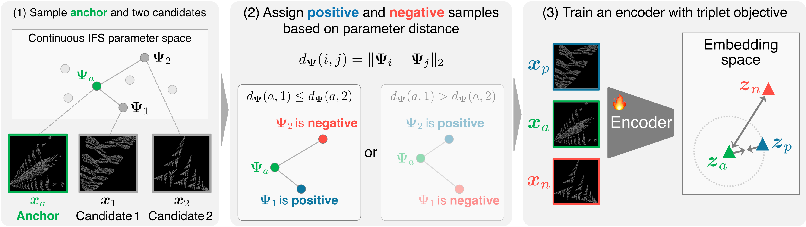
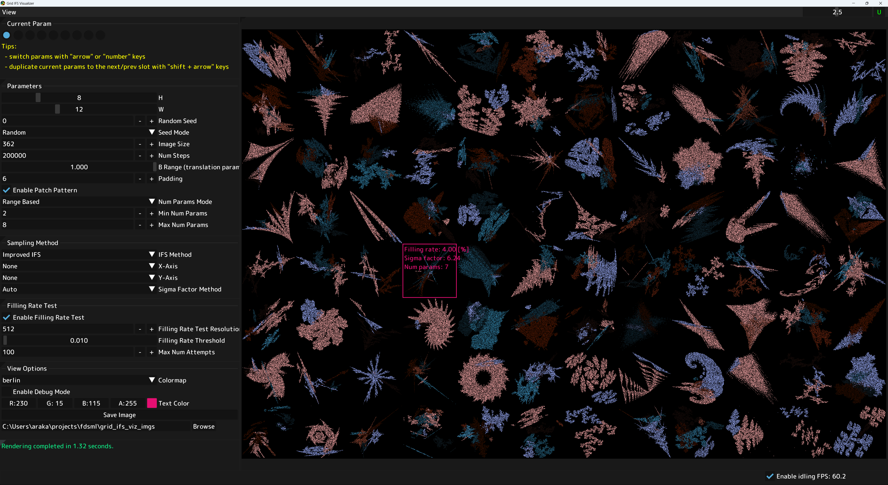

## FDSML &mdash; Official PyTorch implementation



**FDSML: Formula-Driven Supervised Metric Learning with Parameter-Aware Triplet Loss** (WACV 2027)<br>
Hina Otake*, Shinei Arakawa*, Keitaro Tanaka*, Yoshihiro Fukuhara, Hirokatsu Kataoka, Shigeo Morishima (*equal contribution)<br>
[[paper]](https://arxiv.org/abs/2610.39423) [[project page]](https://shineiarakawa.github.io/fdsml/)<br>

## Requirements

- Linux is supported for training. Linux or Windows is supported for inference.
- 4+ high-end NVIDIA GPUs are recommended for training. We have trained our models on NVIDIA H200 or RTX A6000 GPUs. For inference, a single GPU is sufficient.
- 64-bit Python 3.11+ and PyTorch 2.0+ are required. See [https://pytorch.org](https://pytorch.org) for PyTorch install instructions.
- All dependencies are managed with `uv`. See [this page](https://docs.astral.sh/uv/getting-started/installation) for `uv` install instructions. To install dependencies, run `uv sync` in the project root directory. Make sure to activate the `uv` environment before running any scripts (e.g., `source .venv/bin/activate`).

## Fine-tuning

FDSML pre-trained models can be fine-tuned on downstream tasks such as image classification and image retrieval. For example, to fine-tune a pre-trained DeiT-Base model on ImageNet-1K for image classification, run the following command:

```bash
# Fine-tune the pre-trained DeiT-Base model on ImageNet-1K using 4 GPUs
torchrun --standalone --nproc_per_node=4 finetune.py \
    --run_dir_root=out/fdsml \
    --net=deit_base_patch16_224_mocov3_fdsml_each_pretrained \
    --freeze_patch_proj \
    --dset=datasets/imagenet1k \
    --batch_gpu=512
```

This example performs single-node distributed training, which takes about 7.5 days using 4x NVIDIA RTX A6000 GPUs. We recommend using more GPUs if available to speed up training. For example, using 8x NVIDIA H200 GPUs can reduce the training time to about 1.5 days. You can adjust the batch size and the number of GPUs to speed up training, but please make sure to adjust the learning rate accordingly. In the example above, the total batch size is 4096 (set by the default `--batch_size=4096`) and the batch size per GPU is 512 (controlled by `--batch_gpu=512`). This setting runs fine-tuning for 1,000 epochs, which is equivalent to processing approximately 1.28B images. You can also specify the total number of images to process with the `--total_nimg` flag.

ImageNet-1K training is the most computationally intensive fine-tuning task evaluated in the paper. Training on smaller datasets such as CIFAR-10/100, ImageNet-100, or Stanford Cars is more efficient and can typically be completed within a day using 4 GPUs.

The `--net` option specifies the model architecture or pre-trained model to fine-tune. When a model name ending with `_pretrained` is specified, the fine-tuning script automatically resolves the corresponding checkpoint and downloads it from our [Hugging Face organization](https://huggingface.co/fdsml) (FDSML models) or Google Drive (FDSL baselines) if it is not already available locally. Checkpoint downloading is handled internally by the model-selection utilities. Downloaded files are cached locally, so the same checkpoint will not be downloaded again in subsequent runs. If `DNNLIB_CACHE_DIR` is set, it is used as the cache root; otherwise, the cache is placed under `$HOME/.cache/dnnlib` when available. Available scratch and pre-trained models and their pre-training configurations are listed in the table below.

| Name                                                | Base net  | Pre-training Method | Pre-training Dataset |
| --------------------------------------------------- | --------- | ------------------- | -------------------- |
| resnet18                                            | ResNet-18 | -                   | -                    |
| resnet18_imagenet_pretrained                        | ResNet-18 | Supervised          | ImageNet-1K          |
| resnet18_fdsl_pretrained                            | ResNet-18 | FDSL                | FractalDB            |
| resnet34                                            | ResNet-34 | -                   | -                    |
| resnet34_imagenet_pretrained                        | ResNet-34 | Supervised          | ImageNet-1K          |
| resnet34_fdsl_pretrained                            | ResNet-34 | FDSL                | FractalDB            |
| resnet50                                            | ResNet-50 | -                   | -                    |
| resnet50_imagenet_pretrained                        | ResNet-50 | Supervised          | ImageNet-1K          |
| resnet50_fdsl_pretrained                            | ResNet-50 | FDSL                | FractalDB            |
| resnet50_fdsml_all_pretrained                       | ResNet-50 | FDSML               | FineFractalDB        |
| resnet50_fdsml_each_pretrained                      | ResNet-50 | FDSML               | FineFractalDB        |
| resnet50_fdsml_same_pretrained                      | ResNet-50 | FDSML               | FineFractalDB        |
| resnet50_fdsml_diff_pretrained                      | ResNet-50 | FDSML               | FineFractalDB        |
| deit_tiny_patch16_224                               | ViT-Tiny  | -                   | -                    |
| deit_tiny_patch16_224_imagenet_pretrained           | ViT-Tiny  | Supervised          | ImageNet-1K          |
| deit_tiny_patch16_224_fdsl_pretrained               | ViT-Tiny  | FDSL                | FractalDB            |
| deit_tiny_patch16_224_mocov3                        | ViT-Tiny  | -                   | -                    |
| deit_tiny_patch16_224_mocov3_fdsml_all_pretrained   | ViT-Tiny  | FDSML               | FineFractalDB        |
| deit_tiny_patch16_224_mocov3_fdsml_each_pretrained  | ViT-Tiny  | FDSML               | FineFractalDB        |
| deit_tiny_patch16_224_mocov3_fdsml_same_pretrained  | ViT-Tiny  | FDSML               | FineFractalDB        |
| deit_tiny_patch16_224_mocov3_fdsml_diff_pretrained  | ViT-Tiny  | FDSML               | FineFractalDB        |
| deit_base_patch16_224                               | ViT-Base  | -                   | -                    |
| deit_base_patch16_224_imagenet_pretrained           | ViT-Base  | Supervised          | ImageNet-1K          |
| deit_base_patch16_224_fdsl_pretrained               | ViT-Base  | FDSL                | FractalDB            |
| deit_base_patch16_224_mocov3                        | ViT-Base  | -                   | -                    |
| deit_base_patch16_224_mocov3_fdsml_all_pretrained   | ViT-Base  | FDSML               | FineFractalDB        |
| deit_base_patch16_224_mocov3_fdsml_each_pretrained  | ViT-Base  | FDSML               | FineFractalDB        |
| deit_base_patch16_224_mocov3_fdsml_same_pretrained  | ViT-Base  | FDSML               | FineFractalDB        |
| deit_base_patch16_224_mocov3_fdsml_diff_pretrained  | ViT-Base  | FDSML               | FineFractalDB        |

To fine-tune from a checkpoint that is not automatically resolved from `--net`, specify the checkpoint path explicitly with `--ckpt`:

```bash
torchrun --standalone --nproc_per_node=4 finetune.py \
    --run_dir_root=out/fdsml \
    --net=deit_base_patch16_224_mocov3 \
    --ckpt=/path/to/checkpoint.pt \
    --freeze_patch_proj \
    --dset=datasets/imagenet1k \
    --batch_gpu=512
```

The `--ckpt` option also accepts HTTP(S), Google Drive, and SSH paths. For example, a checkpoint on a remote server can be specified as:

```bash
--ckpt=gpu-server:/home/your_user/checkpoints/checkpoint.pt
```

where `gpu-server` is an alias defined in `~/.ssh/config`. The checkpoint is downloaded and cached locally before loading.

For image retrieval, we used [Proxy-Anchor](https://github.com/sung-yeon-kim/Proxy-Anchor-CVPR2020) to fine-tune and evaluate the pre-trained models. For robustness evaluation, we used [hendrycks/robustness](https://github.com/hendrycks/robustness).

## Generate FineFractalDB

FineFractalDB is a synthetic image dataset consisting of 1,000 classes and 1,000 images per class. Each class corresponds to one Iterated Function System (IFS), and each image is generated by rendering the corresponding fractal object with randomized instance-level parameters.

To reproduce the dataset setting used in our experiments, use the following configuration:

```text
Random seed:                    0
Number of classes:              1,000
Number of images per class:     1,000
Total number of images:         1,000,000
Image directory:                datasets/finefractaldb/images
Parameter directory:            datasets/finefractaldb/params
IFS parameter file:             datasets/finefractaldb/ifs_params.pkl
Parameter cache file:           datasets/finefractaldb/params/params.pt
```

We recommend keeping the generated dataset under `datasets/finefractaldb` so that the commands in this README work without modification. The generated image directory follows the standard image-folder format, where each class has its own subdirectory. The corresponding parameter files are saved separately under `datasets/finefractaldb/params`.

A typical directory structure is:

```text
datasets/finefractaldb/
├── ifs_params.pkl
├── images/
│   ├── 00000/
│   │   ├── 00000_00000_00000000.png
│   │   ├── 00000_00001_00000001.png
│   │   └── ...
│   ├── 00001/
│   └── ...
└── params/
    ├── 00000/
    │   ├── 00000_00000.csv
    │   ├── 00000_00001.csv
    │   └── ...
    ├── 00001/
    └── params.pt
```

The parameter mean and standard deviation used during pre-training must match the generated IFS parameters. After generating the dataset, compute these statistics with `tools/compute_param_stats.py` (see step 3 below) and pass the resulting values to `pretrain.py` using `--param_mean` and `--param_std`. If you regenerate the IFS parameters, you should recompute these statistics instead of reusing the values from another dataset.

To generate FineFractalDB, run the following commands:

1. Sample 1,000 IFS parameters and save them to a single pickle file somewhere (e.g., `datasets/finefractaldb/ifs_params.pkl`):

    ```bash
    # Generate 1,000 IFS parameters and save them to a pickle file
    python -m finefractaldb.ifs \
        --save_path=datasets/finefractaldb/ifs_params.pkl \
        --num_systems=1000
    ```

2. Render fractal images from the IFS parameters. This will generate 1,000,000 images (1,000 classes x 1,000 images per class) and save them to `datasets/finefractaldb/images`:

    ```bash
    # Render the fractal images based on the generated parameters
    python -m finefractaldb.render \
        --param_file=datasets/finefractaldb/ifs_params.pkl \
        --out_dir=datasets/finefractaldb \
        --patch
    ```

    The `--patch` flag enables rendering each IFS point as a `3x3` patch of pixels instead of a single pixel, which improves the performance of pre-training, as reported in [FDSL paper](https://arxiv.org/abs/2101.08515). This will take ~15 minutes with a 4-core CPU.

3. Compute the mean and standard deviation of the IFS parameters from the CSV files generated in step 2. These values will be used for normalization during training:

    ```bash
    # Compute mean and std of parameters. These values will be used for normalization during training.
    python -m tools.compute_param_stats \
        --param_dir=datasets/finefractaldb/params
    ```

    This will take ~15 minutes. The computed mean and std values will be printed in the terminal. Please save these values for training.

4. Create a cache file for the parameters. This cache file is not necessary but will speed up loading the parameters at the beginning of each pre-training job:

    ```bash
    # Create a cache file that contains all parameters in a single file for faster loading during training.
    python -m tools.create_param_cache \
        --param_dir datasets/finefractaldb/params
    ```

    The generated cache file will be saved to `datasets/finefractaldb/params/params.pt` and will be automatically used during training if it exists.

## Interactive visualization of FractalDB/FineFractalDB



This repository also includes a viewer for interactively visualizing the fractal images and their corresponding parameters, including four visualizers:

- `viz/ifs_viz.py`: A viewer for visualizing the IFS parameters and their corresponding fractal images. This viewer is useful for understanding the relationship between the IFS parameters and the generated fractal images.
- `viz/distance_viz.py`: A viewer for visualizing the distance relationships between images in the parameter space and the image space. This viewer is useful for understanding how the parameter space and image space relate to each other.
- `viz/grid_ifs_viz.py`: A viewer for visualizing the IFS parameters in a grid layout. This viewer is useful for understanding the distribution of the IFS parameters.
- `viz/ifs_viz_3d.py`: A 3D variant of `viz/ifs_viz.py` for visualizing 3D IFS parameters and the corresponding 3D fractals rendered as point clouds.

We recommend using a Windows/Linux machine with an NVIDIA GPU for running the visualizer, as it relies on CUDA-OpenGL interoperability for efficient image upload and display. With macOS, the visualizer runs but the performance may be degraded due to the lack of MPS-interoperability support.

To launch the visualizer:

1. Install the additional dependencies for visualization. The `viz` dependency group builds `nfdpy` (native file dialogs) from source, so a C++ compiler and the GTK 3 development headers are required on Linux. The CUDA-OpenGL interoperability plugin is JIT-compiled on first launch, which additionally requires the OpenGL/GLEW/EGL development packages and a CUDA toolkit (`nvcc`) matching the CUDA version of the installed PyTorch. If the plugin fails to build, the visualizer still works, but images are uploaded through CPU memory instead. On Ubuntu/Debian:

    ```bash
    sudo apt install build-essential libgtk-3-dev libgl-dev libegl-dev libglew-dev

    uv sync --group viz
    ```

2. Run the visualizer script. For example, to launch the IFS visualizer:

    ```bash
    python viz/ifs_viz.py
    ```

## Pre-training new models

New models can be pre-trained from scratch on FineFractalDB using the `pretrain.py` script. The script reports training status to Weights & Biases (wandb) by default, so please make sure to set up a wandb account and API key if you want to track the training progress. You can also disable wandb logging with the `--disable_wandb` flag. For example, to pre-train a DeiT-Base model with Parameter-Aware Triplet Loss using **each** filtering strategy (see the paper for details), run the following command:

```bash
# Pre-train DeiT-Base model for FineFractalDB using 4 GPUs
torchrun --standalone --nproc_per_node=4 pretrain.py \
    --run_dir_root=out/fdsml \
    --net=deit_base_patch16_224_mocov3 \
    --projection_dim=256 \
    --freeze_patch_proj \
    --miner=each_class \
    --dset=datasets/finefractaldb/images \
    --param_dir=datasets/finefractaldb/params \
    --param_mean -0.00020501 -0.01737614 0.01417852 -0.00803842 0.01674297 0.02324245 \
    --param_std 0.44203399 0.45483486 0.45470102 0.44323780 0.44413787 0.42966211 \
    --aug=autoaug \
    --batch_gpu=256
```

This example performs single-node distributed training, which takes about 3 days using 4x NVIDIA RTX A6000 GPUs. You can adjust the batch size and number of GPUs to speed up training, but please make sure to adjust the learning rate accordingly. In the above example, the total batch size is 4096 (set by the default `--batch_size=4096`) and the batch size per GPU is 256 (controlled by `--batch_gpu=256`), so 4 (= 4096 / (256 $\times$ 4)) gradient accumulation steps are performed before each optimizer step. Note that modifying `--batch_gpu` non-linearly affects the number of triplets within each batch, which may affect the training dynamics. We recommend using a batch size of at least 256 per GPU for stable training.

The above used mean (`--param_mean`) and std (`--param_std`) values for parameters are computed from the sampled IFS parameters (see the "Generate FineFractalDB" section above). If you use different IFS parameters, please make sure to set the correct mean and std values for normalization.

The exact configurations used for each model in the paper (ResNet-50, ViT-Tiny, and ViT-Base, each with the all/each/same/diff strategies) are provided as shell scripts under [`scripts/`](./scripts/). Note that the learning rate, batch composition, and data augmentation settings differ between architectures, so please refer to these scripts when reproducing the results.

Each training run will be saved to a separate directory under `out/fdsml` (controlled by `--run_dir_root`). The name of the run directory is automatically generated based on the training settings with a unique ascending prefix number (e.g., `out/fdsml/00056-fdsml-*`).

By default, the training script prints status every 256Ki (= 256 [kibi](https://en.wikipedia.org/wiki/Binary_prefix#kibi) = $256\times2^{10}$) training images (controlled by `--status_nimg`), saves network checkpoints every 4Mi (= $4\times2^{20}$) training images (controlled by `--checkpoint_nimg`), and dumps training snapshots every 32Mi training images (controlled by `--snapshot_nimg`). The status is saved in `log_rank={rank}.log` (one-line summary) and `stats.jsonl` (comprehensive set of statistics). The network checkpoints are saved in `checkpoints/checkpoint-*kimg-*ep.pt`.

You can resume training from a training snapshot by specifying the path to the snapshot file with the `--resume_snapshot` flag. Make sure to specify the exact same training settings when resuming training.

See [`python pretrain.py --help`](./pretrain.py) for the full list of options for pre-training.

## (Optional) Preparing ImageNet-100 dataset

The ImageNet-100 dataset is a subset of ImageNet-1K that contains 100 classes, which is used for evaluation in the [FDSL paper](https://hirokatsukataoka16.github.io/Pretraining-without-Natural-Images/). To prepare the ImageNet-100 dataset:

1. Download ILSVRC2012 data from the official website: https://www.image-net.org/index.php and extract it somewhere, e.g., `datasets/imagenet_all`. You will need to register and request access to download the dataset. The script expects the dataset to be organized in the image-folder format, where the class subdirectories under `train/` and `val/` are named by the 5-digit class index (`00000` to `00999`, in the standard order of sorted WordNet IDs as in torchvision's `imagenet_class_index.json`). Please convert the raw ILSVRC2012 archives into this layout beforehand:

    ```text
    datasets/imagenet_all/
    ├── train/
    │   ├── 00000/
    │   ├── 00001/
    │   └── ...
    └── val/
        ├── 00000/
        ├── 00001/
        └── ...
    ```

2. Edit `tools/create_imagenet100.py` to set the correct paths for the downloaded data and output directory.

    ```python
    # Edit the paths below to point to the correct locations on your system
    imagenet_root = pathlib.Path('datasets/imagenet_all').resolve()
    imagenet100_root = pathlib.Path('datasets/imagenet100').resolve()
    ```

3. Run the script to create the ImageNet-100 dataset:

    ```bash
    # Create ImageNet-100 dataset from the downloaded ImageNet-1K data
    python -m tools.create_imagenet100
    ```

This will create the ImageNet-100 dataset in `datasets/imagenet100` with the same directory structure as ImageNet-1K (i.e., image-folder style). The 100 classes included in ImageNet-100 are hard-coded in the script.

## License and third-party code

This repository is distributed under the Creative Commons Attribution-NonCommercial-ShareAlike 4.0 International License (CC BY-NC-SA 4.0). Please note that this license permits non-commercial use only.

This repository includes code derived from or inspired by the following projects:

- [NVlabs/edm2](https://github.com/NVlabs/edm2), licensed under CC BY-NC-SA 4.0.
- [harskish/pyviewer](https://github.com/harskish/pyviewer), licensed under CC BY-NC-SA 4.0.
- [catalys1/fractal-pretraining](https://github.com/catalys1/fractal-pretraining), licensed under the MIT License.
- [hirokatsukataoka16/FractalDB-Pretrained-ResNet-PyTorch](https://github.com/hirokatsukataoka16/FractalDB-Pretrained-ResNet-PyTorch), licensed under the MIT License.
- [nakashima-kodai/FractalDB-Pretrained-ViT-PyTorch](https://github.com/nakashima-kodai/FractalDB-Pretrained-ViT-PyTorch), licensed under the MIT License.

See [NOTICE.md](./NOTICE.md) and the license files under [docs/](./docs/) for detailed attribution and license information.

## Citation

```
@inproceedings{Otake2027fdsml,
  title     = {FDSML: Formula-Driven Supervised Metric Learning with Parameter-Aware Triplet Loss},
  author    = {Hina Otake and Shinei Arakawa and Keitaro Tanaka and Yoshihiro Fukuhara and Hirokatsu Kataoka and Shigeo Morishima},
  booktitle = {Proceedings of the IEEE/CVF Winter Conference on Applications of Computer Vision (WACV)},
  year      = {2027},
}
```

## Acknowledgements

This repository template is built on top of the [edm2](https://github.com/NVlabs/edm2) repository. We thank the authors for their great work and for open-sourcing their code. This work was supported by JSPS KAKENHI Grant Numbers JP24H00742 and JP24H00748, JST SPRING Grant Number JPMJSP2128, and computational resources of ABCI 3.0 provided by AIST and AIST Solutions.

